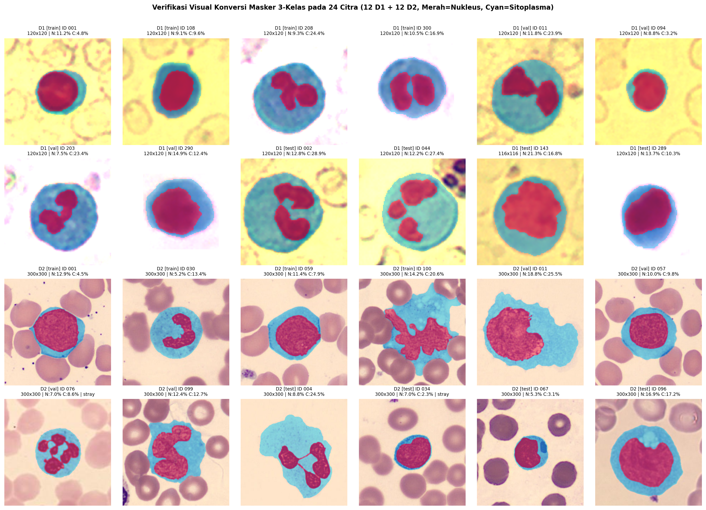
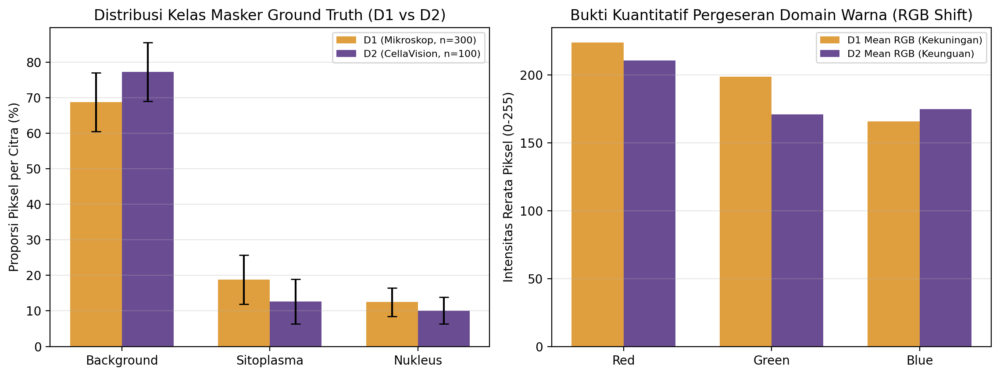
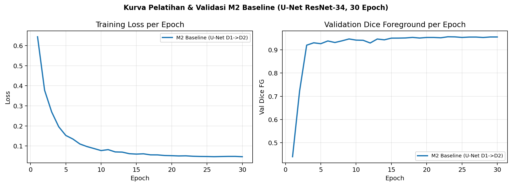
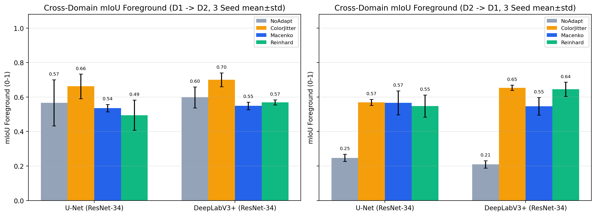
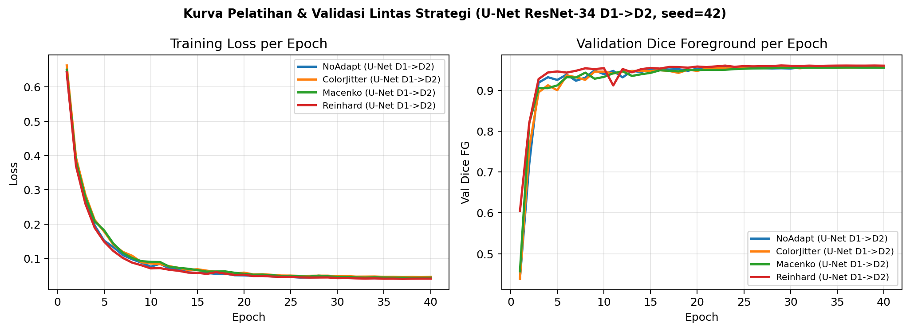
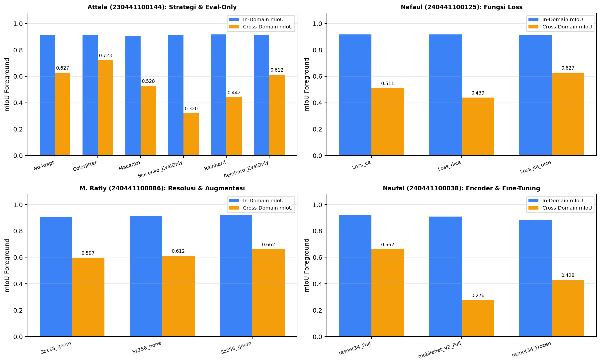
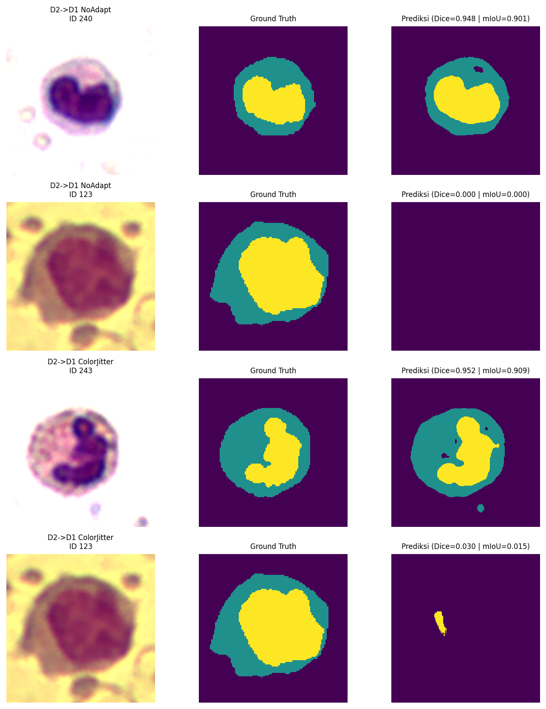
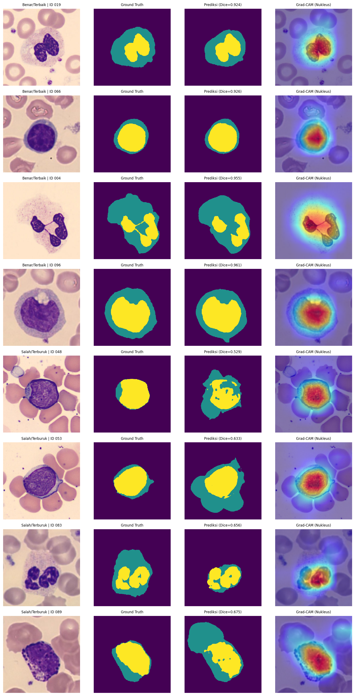
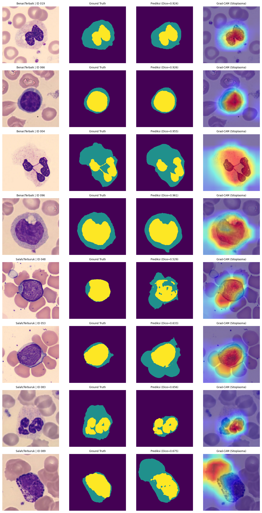

# Tugas Besar Pengganti UAS — Sub-Topik T3-A
## Augmentasi Warna vs *Stain Normalization* pada Segmentasi Semantik Nukleus–Sitoplasma Sel Darah Putih Lintas Domain

**Mata Kuliah:** Deep Learning for Image – Computer Vision Lanjutan (Kelas A)  
**Dosen Pengampu:** Dr. Wahyudi Setiawan, S.Kom., M.Kom.  
**Program Studi:** S1 Sistem Informasi, Fakultas Teknik, Universitas Trunojoyo Madura  

### Identitas Tim (Kelompok 6)

| No | NIM | Nama Lengkap | Peran Utama | Studi Ablasi (1-Faktor) |
| :---: | :--- | :--- | :--- | :--- |
| 1 | `230441100144` | **Attala Alif Ramadhani Tri Hida** | Ketua tim, integrasi pipeline, Model U-Net & laporan | Strategi adaptasi warna (*NoAdapt vs ColorJitter vs Macenko vs Reinhard*) |
| 2 | `240441100125` | **Nafaul Hernanda Romadlona** | Audit data & EDA, deduplikasi *split* & logging | Fungsi *loss* (*Cross-Entropy vs Dice Loss vs CE+Dice*) |
| 3 | `240441100086` | **M. Rafly Kurniawan** | Model DeepLabV3+, eksekusi multi-seed & efisiensi | Resolusi masukan & augmentasi (`128×128` vs `256×256`, `none` vs `geom`) |
| 4 | `240441100038` | **Naufal Husain** | Metrik evaluasi per citra, *error gallery* & Grad-CAM | Pilihan *encoder* & *fine-tuning* (*ResNet-34 Full vs MobileNetV2 Full vs ResNet-34 Frozen*) |

---

## 1. Deskripsi Masalah & Dataset Resmi (`Zheng D1/D2`)

Model segmentasi sel darah putih (*White Blood Cell / WBC*) sering mengalami penurunan performa tajam (*domain shift*) saat dipindahkan ke laboratorium dengan alat mikroskop dan pewarnaan yang berbeda. Proyek ini menguji masalah tersebut menggunakan dataset resmi dari **Mendeley Data**:

* **Sumber & Sitasi:** Zheng, X., Wang, Y., Wang, G., & Liu, J. (2018). *Fast and robust segmentation of white blood cell images by self-supervised learning*. Micron, 107, 55–71. DOI: [`10.17632/w7cvnmn4c5.1`](https://data.mendeley.com/datasets/w7cvnmn4c5/1)
* **Domain 1 (`D1`):** 300 citra dari mikroskop optik Motic Moticam Pro 252A / N800-D berlatar kekuningan (rerata RGB `[223.76, 198.81, 165.68]`).
* **Domain 2 (`D2`):** 100 citra berukuran `300×300` dari mesin scanner otomatis CellaVision berlatar keunguan (rerata RGB `[210.52, 171.04, 174.68]`).
* **Kelas Segmentasi:** `0 = Latar Belakang (termasuk RBC)`, `1 = Sitoplasma`, `2 = Nukleus`.

> **Etika Data Medis:** Sesuai ketentuan proyek, berkas dataset mentah **tidak disebarkan ulang** di repositori ini (diabaikan melalui `.gitignore`). Skrip [`src/dataset.py`](src/dataset.py) mengunduh data secara otomatis langsung dari tautan resmi Mendeley Data.

---

## 2. Hasil Audit Data, Verifikasi Visual, & Evaluasi Baseline (Milestone M2)

Audit lengkap oleh [`src/audit_eda.py`](src/audit_eda.py) ([`logs/data_audit_report.json`](logs/data_audit_report.json), [`logs/data_audit_per_image.csv`](logs/data_audit_per_image.csv)) menuntaskan pemeriksaan pada seluruh 400 citra sebelum pelatihan model:

1. **Dimensi `D1` Tidak Seragam:** Meski sering disebut `120×120`, terdapat **30 variasi ukuran** di `D1` (`88×88` hingga `120×120`; `224/300` citra berukuran `120×120`). Seluruh citra diseragamkan ke `256×256` (`BILINEAR` untuk citra, `NEAREST` untuk masker).
2. **Piksel Artefak pada Masker `D2`:** Sebanyak **5 berkas masker `D2`** (`034, 035, 047, 050, 076.png`) memiliki piksel artefak latar bernilai `2–50` di luar nilai standar `[0, 128, 255]`. Fungsi [`encode_mask_to_classes`](src/dataset.py) melakukan kuantisasi ambang bersih ke `{0, 1, 2}` agar bebas galat indeks kelas saat pelatihan.
3. **Deteksi Duplikat & Split Anti-Kebocoran (`seed=42`):** Pemeriksaan SHA-256 dan *perceptual dHash* menemukan 1 pasangan duplikat eksak (`D1/112` & `D1/139`, `MAE = 0.0`) serta 1 pasangan sangat mirip (`D1/166` & `D1/171`, `dHash = 2 bit`). Algoritma *group-aware split* menempatkan pasangan kembar ke dalam `train` sehingga tercatat **0 kebocoran antarsubset (`train/val/test`) maupun antardomain**.
   * **`splits/zheng_d1_split.csv`:** `210` Train / `45` Val / `45` Test
   * **`splits/zheng_d2_split.csv`:** `70` Train / `15` Val / `15` Test
4. **Verifikasi Visual Konversi 24 Citra, Komponen Objek & Rasio N:C:** Overlay masker 3 kelas diverifikasi secara visual pada **24 citra sampel** (`12 D1 + 12 D2` melintasi `train/val/test`) tanpa kegagalan konversi. Kedua domain memiliki rata-rata **`1.00` sel/citra**, komponen nukleus rata-rata `1.25` (maks `3`) di `D1` vs `1.11` (maks `3`) di `D2`, dan rasio luas nukleus terhadap sitoplasma (**N:C ratio**) `0.81 ± 0.50` (`D1`) vs `1.06 ± 0.87` (`D2`).

### Ringkasan Evaluasi Model Baseline M2 (`U-Net + ResNet-34`, Google Colab `Tesla T4`)

Pelatihan baseline (`seed=42`, `30 epoch`, loss `ce_dice`, input `256×256`, augmentasi geometrik standar `geom`, tanpa `ColorJitter` maupun *stain normalization*) berjalan selama **143,91 detik**, mencapai checkpoint validasi terbaik **`val_dice_fg = 0.9562`** pada epoch ke-23, serta kecepatan inferensi `batch=1` **`7.946 ± 0.879 ms/citra` (`125.85 FPS`)** dengan **`24.437M` parameter** ([`logs/m2_baseline_runs.csv`](logs/m2_baseline_runs.csv)):

| Skenario Evaluasi | Dice Nucleus | Dice Cytoplasm | mIoU Foreground | HD95 Nucleus | HD95 Cytoplasm |
| :--- | :---: | :---: | :---: | :---: | :---: |
| **In-Domain Test (`D1 test`, n=45)** | `0.9679 ± 0.0143` | `0.9409 ± 0.0314` | `0.9140 ± 0.0327` | `2.68 ± 1.56 px` | `2.93 ± 1.03 px` |
| **Cross-Domain Test (`D2 test`, n=15)** | `0.7854 ± 0.2334` | `0.4595 ± 0.2746` | `0.5175 ± 0.2359` | `33.10 ± 25.84 px` | `48.48 ± 29.72 px` |
| **Selisih Domain Shift (`D1 -> D2`)** | **`-0.1825`** | **`-0.4814`** | **`-0.3965`** | **`+30.42 px`** | **`+45.55 px`** |

* **IoU per Kelas:** In-Domain `Nukleus = 0.9381 ± 0.0264`, `Sitoplasma = 0.8899 ± 0.0539`; Cross-Domain `Nukleus = 0.6933 ± 0.2645`, `Sitoplasma = 0.3418 ± 0.2657`.
* **Audit Kesalahan & Ukuran Objek (`D2 test`):** Dari `15` citra uji `D2` ([`logs/m2_baseline_per_image.csv`](logs/m2_baseline_per_image.csv)), ditemukan `7` kasus deviasi kontur tepi ringan, `4` *under-segmentation* sitoplasma, `2` kegagalan berat (mis. `ID 088` Dice `0.200`), dan `2` *over-segmentation*; berdasarkan ukuran objek ([`logs/m2_baseline_size_breakdown.csv`](logs/m2_baseline_size_breakdown.csv)), kelompok sel **Besar** mengalami penurunan tertinggi (`mIoU 0.4879` vs Sedang `0.5193` dan Kecil `0.5455`).

<p align="center">
  
  <br/><em>Gambar 1. Perbandingan visual & anotasi pakar D1 (mikroskop kekuningan) vs D2 (CellaVision keunguan).</em>
</p>

<p align="center">
  
  <br/><em>Gambar 2. Verifikasi visual konversi masker 3-kelas pada 24 citra sampel (12 D1 + 12 D2 melintasi train/val/test).</em>
</p>

<p align="center">
  
  <br/><em>Gambar 3. Proporsi luas kelas (kiri) dan bukti kuantitatif pergeseran kanal warna RGB antardomain (kanan).</em>
</p>

<p align="center">
  
  <br/><em>Gambar 4. Sebaran luas objek nukleus-sitoplasma, distribusi rasio N:C per citra, dan variasi resolusi asli (D1 30 variasi vs D2 300x300).</em>
</p>

<p align="center">
  
  <br/><em>Gambar 5. Uji visual Macenko & Reinhard Stain Normalization dari D1 ke referensi citra latih D2.</em>
</p>

<p align="center">
  
  <br/><em>Gambar 6. Kurva train loss & validation Dice foreground baseline U-Net ResNet-34 (30 epoch; terbaik 0.9562 pada epoch 23).</em>
</p>

<p align="center">
  
  <br/><em>Gambar 7. Contoh prediksi baseline U-Net ResNet-34 pada uji In-Domain (D1) vs Cross-Domain (D2).</em>
</p>

---

## 3. Hasil Eksperimen Utama, Studi Ablasi, & Analisis XAI (Milestone M3)

Seluruh **59 run GPU (`Tesla T4`)** selesai dengan status **100% sukses (`59/59`)**: **48 run eksperimen utama** (`2 arah x 2 arsitektur x 4 strategi x 3 seed [42, 123, 999]`) dan **11 run ablasi khusus** ([`logs/m3_experiment_runs.csv`](logs/m3_experiment_runs.csv), seluruh histori tersimpan di `logs/histories/`).

### A. Matriks Eksperimen Utama Lintas Domain (3-Seed `mean ± std`)

| Arah | Arsitektur | Strategi | In-Domain mIoU Fg | Cross-Domain mIoU Fg | Cross Dice Nuc | Cross Dice Cyto | Cross HD95 Nuc / Cyto (px) | Drop mIoU |
| :--- | :--- | :--- | :---: | :---: | :---: | :---: | :---: | :---: |
| `D1 -> D2` | `DeepLabV3+` | **`ColorJitter`** | `0.9175 ± 0.0006` | **`0.6995 ± 0.0404`** | `0.9139 ± 0.0269` | `0.6600 ± 0.0463` | `22.73 / 28.40` | **`0.2180`** |
| `D1 -> D2` | `DeepLabV3+` | `NoAdapt` | `0.9157 ± 0.0053` | `0.5977 ± 0.0607` | `0.9120 ± 0.0033` | `0.4515 ± 0.1247` | `12.76 / 54.13` | `0.3180` |
| `D1 -> D2` | `DeepLabV3+` | `Reinhard` | `0.9172 ± 0.0011` | `0.5690 ± 0.0148` | `0.9116 ± 0.0315` | `0.3910 ± 0.0451` | `8.30 / 48.51` | `0.3482` |
| `D1 -> D2` | `DeepLabV3+` | `Macenko` | `0.9092 ± 0.0013` | `0.5485 ± 0.0219` | `0.8815 ± 0.0212` | `0.4018 ± 0.0547` | `14.15 / 53.63` | `0.3607` |
| `D1 -> D2` | `U-Net` | **`ColorJitter`** | `0.9163 ± 0.0014` | `0.6618 ± 0.0709` | `0.8874 ± 0.0714` | `0.6238 ± 0.0504` | `19.71 / 32.39` | `0.2545` |
| `D1 -> D2` | `U-Net` | `NoAdapt` | `0.9151 ± 0.0035` | `0.5658 ± 0.1335` | `0.8436 ± 0.1471` | `0.4738 ± 0.1273` | `19.77 / 58.59` | `0.3493` |
| `D1 -> D2` | `U-Net` | `Macenko` | `0.9087 ± 0.0023` | `0.5357 ± 0.0216` | `0.8436 ± 0.0430` | `0.4100 ± 0.0286` | `21.65 / 39.79` | `0.3730` |
| `D1 -> D2` | `U-Net` | `Reinhard` | `0.9178 ± 0.0008` | `0.4945 ± 0.0876` | `0.7812 ± 0.1368` | `0.3683 ± 0.0523` | `28.30 / 59.46` | `0.4233` |
| `D2 -> D1` | `DeepLabV3+` | **`ColorJitter`** | `0.8857 ± 0.0031` | **`0.6534 ± 0.0155`** | `0.8413 ± 0.0168` | `0.6828 ± 0.0120` | **`12.57 / 18.64`** | **`0.2323`** |
| `D2 -> D1` | `DeepLabV3+` | `Reinhard` | `0.8771 ± 0.0039` | `0.6449 ± 0.0410` | `0.9380 ± 0.0025` | `0.5288 ± 0.0827` | `6.49 / 29.49` | `0.2322` |
| `D2 -> D1` | `DeepLabV3+` | `Macenko` | `0.8213 ± 0.0051` | `0.5464 ± 0.0509` | `0.8459 ± 0.0179` | `0.4327 ± 0.0918` | `15.67 / 60.91` | `0.2749` |
| `D2 -> D1` | `DeepLabV3+` | `NoAdapt` | `0.8850 ± 0.0087` | `0.2096 ± 0.0213` | `0.3695 ± 0.0245` | `0.1485 ± 0.0110` | `122.05 / 104.02` | `0.6754` |
| `D2 -> D1` | `U-Net` | **`ColorJitter`** | `0.8937 ± 0.0070` | `0.5689 ± 0.0180` | `0.8218 ± 0.0688` | `0.5117 ± 0.0383` | `18.27 / 30.63` | `0.3248` |
| `D2 -> D1` | `U-Net` | `Macenko` | `0.8343 ± 0.0106` | `0.5667 ± 0.0695` | `0.8129 ± 0.0614` | `0.5250 ± 0.0924` | `20.20 / 45.57` | `0.2676` |
| `D2 -> D1` | `U-Net` | `Reinhard` | `0.8856 ± 0.0075` | `0.5481 ± 0.0641` | `0.9024 ± 0.0195` | `0.3741 ± 0.1326` | `12.44 / 38.34` | `0.3376` |
| `D2 -> D1` | `U-Net` | `NoAdapt` | `0.8863 ± 0.0005` | `0.2474 ± 0.0210` | `0.4297 ± 0.0293` | `0.1647 ± 0.0161` | `108.55 / 143.68` | `0.6389` |

* **Uji Statistik Berpasangan ([`logs/m3_statistical_tests.csv`](logs/m3_statistical_tests.csv)):** Pada semua `24` kondisi berpasangan, `DeepLabV3+` mengungguli `U-Net` (`cross mIoU = 0.5586` vs `0.5236`, selisih `+0.0350`, `t = 2.1610`, `p = 0.04135`). Pada arah tersulit **`D2 -> D1`** (latih terbatas dari `70` citra seragam CellaVision), ketiga adaptasi memberikan peningkatan sangat signifikan secara statistik terhadap `NoAdapt`: `DeepLabV3+ + ColorJitter` (`+0.4438`, `p = 0.00196`), `Reinhard` (`+0.4353`, `p = 0.00092`), `Macenko` (`+0.3368`, `p = 0.00945`), dan pada `U-Net`: `ColorJitter` (`+0.3215`, `p = 0.00209`), `Macenko` (`+0.3193`, `p = 0.02531`), `Reinhard` (`+0.3007`, `p = 0.01552`).

### B. Ringkasan 4 Studi Ablasi & Efisiensi Model (`seed=42`, `D1 -> D2`)

* **Attala (`230441100144`) - Strategi Warna & Train+Eval vs Eval-Only (`U-Net`):** `ColorJitter` terbaik (`0.7233`, `+0.0958` vs `NoAdapt 0.6275`); `Reinhard_EvalOnly` (`0.6123`) jauh lebih baik dibanding `Reinhard` penuh (`0.4415`) karena normalisasi saat latih mengikis variasi warna alami data latih (`D1`).
* **Nafaul (`240441100125`) - Fungsi Loss (`U-Net`):** `CE+Dice` (`0.6275`) mengungguli `Cross-Entropy` (`0.5113`, `-0.1162`) dan `Dice` tunggal (`0.4387`, `-0.1888`).
* **M. Rafly (`240441100086`) - Resolusi & Augmentasi Geometrik (`DeepLabV3+`):** `256×256 + geom` terbaik (`0.6623`), unggul dari `256×256 + none` (`0.6124`, `-0.0499`) dan `128×128 + geom` (`0.5974`, `-0.0649`).
* **Naufal (`240441100038`) - Encoder & Fine-Tuning (`DeepLabV3+`):** `ResNet-34 Full Fine-Tuning` terbaik (`0.6623`), melampaui `ResNet-34 Frozen` (`0.4285`, `-0.2338`) maupun `MobileNetV2 Full` (`0.2761`, `-0.3862`).
* **Efisiensi Inferensi (`Tesla T4`, `batch=1`, [`logs/m3_efficiency_summary.csv`](logs/m3_efficiency_summary.csv)):** `U-Net ResNet-34` (`24.437M` param) mencatat `7.299 ms` (`137.01 FPS`), lebih cepat dibanding `DeepLabV3+ ResNet-34` (`22.438M` param, `9.659 ms`, `103.53 FPS`), sementara `DeepLabV3+ MobileNetV2` paling ringan parameter (`4.379M`) tetapi lebih lambat di GPU (`12.872 ms`, `77.69 FPS`) serta gagal generalisasi.

### C. Analisis Kesalahan, Ukuran Objek, & Interpretasi Grad-CAM

* **Penurunan Kegagalan Berat & Stratifikasi Ukuran ([`logs/m3_error_analysis_summary.csv`](logs/m3_error_analysis_summary.csv), [`logs/m3_size_stratified_metrics.csv`](logs/m3_size_stratified_metrics.csv)):** Pada `D2 -> D1`, `ColorJitter` menurunkan kegagalan berat dari `26/45` (`NoAdapt`) menjadi `6/45` serta menaikkan semua kategori ukuran sel (`Kecil 0.3588 -> 0.6668`, `Sedang 0.2912 -> 0.6512`, `Besar 0.1458 -> 0.3542`). Pada `D1 -> D2`, *under-segmentation* sitoplasma turun dari `7/15` menjadi `3/15`.
* **Temuan Grad-CAM:** Aktivasi kelas nukleus terfokus tepat pada kromatin inti (`Gambar 12`), sedangkan pada sitoplasma (`Gambar 13`) model adaptasi terbaik masih sesekali melebar ke eritrosit (RBC) yang menempel pada tepi sel putih (`ID 048, 053, 089`).

<p align="center">
  
  <br/><em>Gambar 8. Perbandingan Cross-Domain mIoU Foreground (3-seed mean±std) U-Net vs DeepLabV3+ pada D1->D2 (kiri) dan D2->D1 (kanan).</em>
</p>

<p align="center">
  
  <br/><em>Gambar 9. Kurva Training Loss & Validation Dice Foreground lintas strategi (U-Net D1->D2, seed=42, 40 epoch).</em>
</p>

<p align="center">
  
  <br/><em>Gambar 10. Perbandingan 4 studi ablasi satu-faktor seluruh anggota Kelompok 6 (In-Domain vs Cross-Domain mIoU).</em>
</p>

<p align="center">
  D1 NoAdapt vs ColorJitter"/>
  <br/><em>Gambar 11. Perbandingan kasus terbaik vs terburuk pada arah D2->D1: NoAdapt (2 baris atas) vs ColorJitter (2 baris bawah); galeri 8 kasus D1->D2 tersedia di fig4a dan fig4b.</em>
</p>

<p align="center">
  
  <br/><em>Gambar 12. Interpretabilitas Grad-CAM kelas Nukleus (4 kasus terbaik vs 4 kasus error terbesar pada D1->D2).</em>
</p>

<p align="center">
  
  <br/><em>Gambar 13. Interpretabilitas Grad-CAM kelas Sitoplasma menunjukkan kebocoran aktivasi ke eritrosit tetangga pada kasus over-segmentasi.</em>
</p>

---

## 4. Struktur Repositori & Panduan Reproduksibilitas (Google Colab)

```text
├── configs/experiment_config.yaml        # Parameter arsitektur, seed (42,123,999), dan matriks uji
├── docs/
│   ├── Proposal_M1_Kelompok6_T3A.docx/.pdf   # Proposal resmi Milestone M1 (2 halaman)
│   ├── Laporan_Kemajuan_M2_Kelompok6_T3A.docx/.pdf # Laporan kemajuan Milestone M2 (1 halaman)
│   └── figures/                              # Visualisasi EDA (M2), error gallery, kurva & Grad-CAM (M3)
├── logs/
│   ├── data_audit_report.json                # Log audit lengkap (dimensi, objek, stray pixel, cek kebocoran)
│   ├── data_audit_per_image.csv              # Tabel audit per citra (400 baris D1 + D2)
│   ├── m2_baseline_runs.csv                  # Log run baseline M2 (U-Net ResNet-34, Tesla T4)
│   ├── m2_baseline_per_image.csv             # Evaluasi per citra uji M2 (45 D1 + 15 D2) & kategori error
│   ├── m2_baseline_size_breakdown.csv        # Rekap performa M2 per kategori ukuran sel (Kecil/Sedang/Besar)
│   ├── m3_experiment_runs.csv                # Log lengkap seluruh 59 run M3 (48 utama + 11 ablasi)
│   ├── m3_main_summary.csv                   # Agregasi 3-seed (mean±std) 16 kondisi utama
│   ├── m3_statistical_tests.csv              # Uji t-berpasangan & Wilcoxon (strategi & paradigma)
│   ├── m3_ablation_summary.csv               # Rekap 4 studi ablasi satu-faktor anggota tim
│   ├── m3_efficiency_summary.csv             # Benchmark parameter, latency (ms) & FPS GPU Tesla T4
│   ├── m3_error_analysis_summary.csv         # Frekuensi kategori kesalahan NoAdapt vs ColorJitter
│   ├── m3_size_stratified_metrics.csv        # Evaluasi stratifikasi ukuran objek (Kecil/Sedang/Besar)
│   ├── m3_xai_per_image_metrics.csv          # Skor metrik per citra uji model seed=42 (D1->D2 & D2->D1)
│   └── histories/                            # Histori train_loss & val_dice_fg per epoch (1 M2 + 59 M3)
├── notebooks/
│   ├── 01_M2_Audit_EDA_Baseline.ipynb    # Notebook Colab M2 (Audit Lengkap, EDA 24-Citra & Baseline)
│   └── 02_M3_Main_Experiments_Ablations_XAI.ipynb  # Notebook Colab M3 (3 Seed, 4 Ablasi, Error Gallery & XAI)
├── splits/                               # Berkas split tetap anti-kebocoran (seed=42)
├── src/
│   ├── audit_eda.py                      # Skrip audit menyeluruh, jumlah/luas objek, dHash & 5 grafik EDA
│   ├── dataset.py                        # Pengunduh Mendeley, label mapper & anti-leakage splitter
│   ├── gdrive_sync.py                    # Sinkronisasi otomatis log, grafik, bobot & arsip ke Google Drive
│   ├── m3_reporting.py                   # Agregasi 3-seed, uji statistik berpasangan, ablasi & grafik M3
│   ├── stain_norm.py                     # Macenko & Reinhard stain normalization (murni NumPy)
│   ├── models.py                         # U-Net vs DeepLabV3+ (pralatih ImageNet), seed locking & loss
│   ├── metrics.py                        # Dice/IoU per kelas, mIoU, HD95 per citra & benchmark latensi
│   ├── trainer.py                        # Pipeline latih, validasi, histori epoch & eksperimen multi-run
│   └── xai_and_errors.py                 # Galeri kesalahan, stratifikasi ukuran objek, kurva & Grad-CAM
└── requirements.txt
```

### Langkah Menjalankan di Google Colab (GPU T4 / Colab Pro)
1. Buka [`notebooks/01_M2_Audit_EDA_Baseline.ipynb`](notebooks/01_M2_Audit_EDA_Baseline.ipynb) di Google Colab (status: **selesai dijalankan** dan hasilnya telah direkap pada [`docs/Laporan_Kemajuan_M2_Kelompok6_T3A.pdf`](docs/Laporan_Kemajuan_M2_Kelompok6_T3A.pdf)) untuk verifikasi audit data menyeluruh, grafik konversi 24 citra, & model baseline (Milestone M2); notebook otomatis menyinkronkan bundel hasil ke folder Google Drive `101PbkgjCD-y_OaZPzRcqZzdgjoCf2ld8` (`M2_Audit_EDA_Baseline/`).
2. Buka [`notebooks/02_M3_Main_Experiments_Ablations_XAI.ipynb`](notebooks/02_M3_Main_Experiments_Ablations_XAI.ipynb) di Google Colab (status: **selesai dijalankan 59/59 run** dan hasilnya tersinkron ke Google Drive `M3_Main_Experiments_XAI/`) lalu pilih **Runtime -> Run all** jika ingin mereproduksi dari nol seluruh 48 run utama (`U-Net` vs `DeepLabV3+` x 3 seed), uji statistik berpasangan, 4 studi ablasi anggota (11 run), tabel efisiensi (`K7`), analisis ukuran objek (`K5`), galeri kesalahan, dan Grad-CAM.
3. Atau jalankan audit data lokal langsung via CLI:
   ```bash
   python src/audit_eda.py
   ```

---

## 5. Deklarasi Etika & Penggunaan Alat Bantu
* Seluruh kode dan model pada repositori ini merupakan **prototipe riset akademik** untuk mata kuliah Computer Vision Lanjutan, **bukan alat diagnosis medis klinis**.
* Asisten AI digunakan untuk membantu perancangan struktur skrip modular, pemeriksaan sintaks, dan penyusunan draf dokumentasi; desain eksperimen, verifikasi audit data, analisis metrik, serta penafsiran ilmiah sepenuhnya diverifikasi oleh anggota Kelompok 6.
