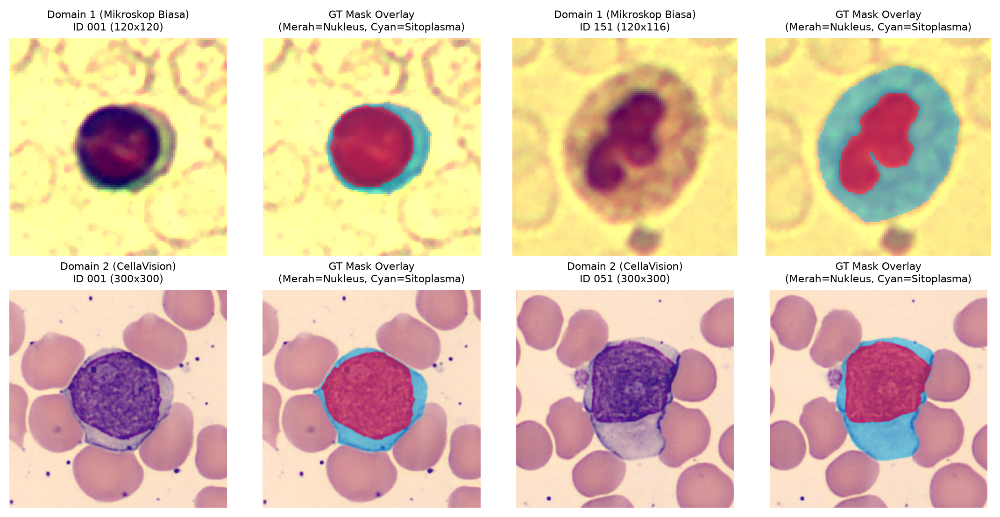
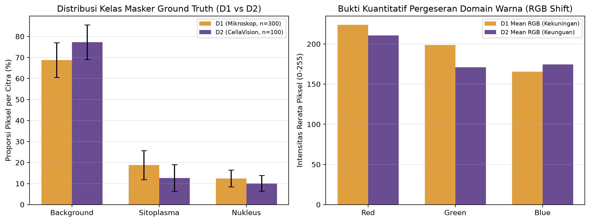
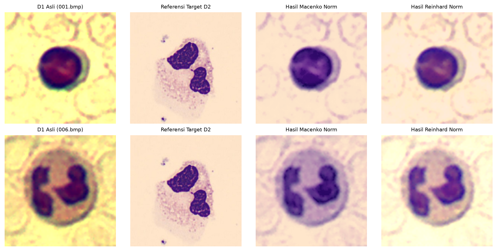

# Tugas Besar Pengganti UAS — Sub-Topik T3-A
## Augmentasi Warna vs *Stain Normalization* pada Segmentasi Semantik Nukleus–Sitoplasma Sel Darah Putih Lintas Domain

**Mata Kuliah:** Deep Learning for Image – Computer Vision Lanjutan (Kelas A)  
**Dosen Pengampu:** Dr. Wahyudi Setiawan, S.Kom., M.Kom.  
**Program Studi:** S1 Sistem Informasi, Fakultas Teknik, Universitas Trunojoyo Madura  

### Identitas Tim (Kelompok 6)

| No | NIM | Nama Lengkap | Peran Utama | Studi Ablasi (1-Faktor) |
| :---: | :--- | :--- | :--- | :--- |
| 1 | `230441100144` | **Attala Alif Ramadhani Tri Hida** | Ketua tim, integrasi pipeline, Model U-Net & laporan | Strategi adaptasi warna (*NoAdapt vs ColorJitter vs Macenko vs Reinhard*) |
| 2 | `240441100125` | **Nafaul Hernanda Romadlona** | Audit data & EDA, deduplikasi *split* & logging | Fungsi *loss* (*Cross-Entropy vs Dice Loss vs CE+Dice*) |
| 3 | `240441100086` | **M. Rafly Kurniawan** | Model DeepLabV3+, eksekusi multi-seed & efisiensi | Resolusi masukan & augmentasi (`128×128` vs `256×256`, `none` vs `geom`) |
| 4 | `240441100038` | **Naufal Husain** | Metrik evaluasi per citra, *error gallery* & Grad-CAM | Pilihan *encoder* & *fine-tuning* (*ResNet-34 Full vs MobileNetV2 Full vs ResNet-34 Frozen*) |

---

## 1. Deskripsi Masalah & Dataset Resmi (`Zheng D1/D2`)

Model segmentasi sel darah putih (*White Blood Cell / WBC*) sering mengalami penurunan performa tajam (*domain shift*) saat dipindahkan ke laboratorium dengan alat mikroskop dan pewarnaan yang berbeda. Proyek ini menguji masalah tersebut menggunakan dataset resmi dari **Mendeley Data**:

* **Sumber & Sitasi:** Zheng, X., Wang, Y., Wang, G., & Liu, J. (2018). *Fast and robust segmentation of white blood cell images by self-supervised learning*. Micron, 107, 55–71. DOI: [`10.17632/w7cvnmn4c5.1`](https://data.mendeley.com/datasets/w7cvnmn4c5/1)
* **Domain 1 (`D1`):** 300 citra dari mikroskop optik Motic Moticam Pro 252A / N800-D berlatar kekuningan (rerata RGB `[223.76, 198.81, 165.68]`).
* **Domain 2 (`D2`):** 100 citra berukuran `300×300` dari mesin scanner otomatis CellaVision berlatar keunguan (rerata RGB `[210.52, 171.04, 174.68]`).
* **Kelas Segmentasi:** `0 = Latar Belakang (termasuk RBC)`, `1 = Sitoplasma`, `2 = Nukleus`.

> **Etika Data Medis:** Sesuai ketentuan proyek, berkas dataset mentah **tidak disebarkan ulang** di repositori ini (diabaikan melalui `.gitignore`). Skrip [`src/dataset.py`](src/dataset.py) mengunduh data secara otomatis langsung dari tautan resmi Mendeley Data.

---

## 2. Hasil Audit Data Awal & Pipeline Anti-Kebocoran (Milestone M2)

Audit lengkap oleh [`src/audit_eda.py`](src/audit_eda.py) (`logs/data_audit_report.json`) menemukan tiga kondisi penting pada data asli yang telah ditangani sebelum pelatihan model:

1. **Dimensi `D1` Tidak Seragam:** Meski sering disebut `120×120`, terdapat **30 variasi ukuran** di `D1` (`88×88` hingga `120×120`; `224/300` citra berukuran `120×120`). Seluruh citra diseragamkan ke `256×256` (`BILINEAR` untuk citra, `NEAREST` untuk masker).
2. **Piksel Artefak pada Masker `D2`:** Sebanyak **5 berkas masker `D2`** (`034, 035, 047, 050, 076.png`) memiliki piksel artefak latar bernilai `2–50` di luar nilai standar `[0, 128, 255]`. Fungsi [`encode_mask_to_classes`](src/dataset.py) melakukan kuantisasi ambang bersih ke `{0, 1, 2}` agar bebas galat indeks kelas saat pelatihan.
3. **Deteksi Duplikat & Split Anti-Kebocoran (`seed=42`):** Pemeriksaan SHA-256 dan *perceptual dHash* menemukan 1 pasangan duplikat eksak (`D1/112` & `D1/139`, `MAE = 0.0`) serta 1 pasangan sangat mirip (`D1/166` & `D1/171`, `dHash = 2 bit`). Algoritma *group-aware split* menempatkan pasangan kembar ke dalam `train` sehingga tercatat **0 kebocoran antarsubset (`train/val/test`) maupun antardomain**.
   * **`splits/zheng_d1_split.csv`:** `210` Train / `45` Val / `45` Test
   * **`splits/zheng_d2_split.csv`:** `70` Train / `15` Val / `15` Test

<p align="center">
  
  <br/><em>Gambar 1. Perbandingan visual & anotasi pakar D1 (mikroskop kekuningan) vs D2 (CellaVision keunguan).</em>
</p>

<p align="center">
  
  <br/><em>Gambar 2. Proporsi luas kelas (kiri) dan bukti kuantitatif pergeseran kanal warna RGB antardomain (kanan).</em>
</p>

<p align="center">
  
  <br/><em>Gambar 3. Uji visual Macenko & Reinhard Stain Normalization dari D1 ke referensi citra latih D2.</em>
</p>

---

## 3. Struktur Repositori & Panduan Reproduksibilitas (Google Colab)

```text
├── configs/experiment_config.yaml        # Parameter arsitektur, seed (42,123,999), dan matriks uji
├── docs/
│   ├── Proposal_M1_Kelompok6_T3A.docx/.pdf   # Proposal resmi Milestone M1 (2 halaman)
│   ├── Laporan_Kemajuan_M2_Kelompok6_T3A.docx/.pdf # Laporan kemajuan Milestone M2 (1 halaman)
│   └── figures/                              # Visualisasi EDA, error gallery & Grad-CAM
├── logs/
│   ├── data_audit_report.json                # Log audit lengkap (dimensi, objek, stray pixel, cek kebocoran)
│   ├── data_audit_per_image.csv              # Tabel audit per citra (400 baris D1 + D2)
│   └── m2_baseline_runs.csv                  # Log run baseline M2 (U-Net ResNet-34, Tesla T4)
├── notebooks/
│   ├── 01_M2_Audit_EDA_Baseline.ipynb    # Notebook Colab M2 (Audit Lengkap, EDA 24-Citra & Baseline)
│   └── 02_M3_Main_Experiments_Ablations_XAI.ipynb  # Notebook Colab M3 (3 Seed, 4 Ablasi, Error Gallery & XAI)
├── splits/                               # Berkas split tetap anti-kebocoran (seed=42)
├── src/
│   ├── audit_eda.py                      # Skrip audit menyeluruh, jumlah/luas objek, dHash & 5 grafik EDA
│   ├── dataset.py                        # Pengunduh Mendeley, label mapper & anti-leakage splitter
│   ├── gdrive_sync.py                    # Sinkronisasi otomatis log, grafik, bobot & arsip ke Google Drive
│   ├── m3_reporting.py                   # Agregasi 3-seed, uji statistik berpasangan, ablasi & grafik M3
│   ├── stain_norm.py                     # Macenko & Reinhard stain normalization (murni NumPy)
│   ├── models.py                         # U-Net vs DeepLabV3+ (pralatih ImageNet), seed locking & loss
│   ├── metrics.py                        # Dice/IoU per kelas, mIoU, HD95 per citra & benchmark latensi
│   ├── trainer.py                        # Pipeline latih, validasi, histori epoch & eksperimen multi-run
│   └── xai_and_errors.py                 # Galeri kesalahan, stratifikasi ukuran objek, kurva & Grad-CAM
└── requirements.txt
```

### Langkah Menjalankan di Google Colab (GPU T4 / Colab Pro)
1. Buka [`notebooks/01_M2_Audit_EDA_Baseline.ipynb`](notebooks/01_M2_Audit_EDA_Baseline.ipynb) di Google Colab untuk verifikasi audit data menyeluruh, grafik konversi 24 citra, & model baseline (Milestone M2), lalu beri izin akses Google Drive saat diminta di Sel 1 agar hasil tersimpan ke folder Drive `101PbkgjCD-y_OaZPzRcqZzdgjoCf2ld8`.
2. Buka [`notebooks/02_M3_Main_Experiments_Ablations_XAI.ipynb`](notebooks/02_M3_Main_Experiments_Ablations_XAI.ipynb) lalu pilih **Runtime -> Run all** untuk mereproduksi dari nol seluruh 48 run utama (`U-Net` vs `DeepLabV3+` x 3 seed), uji statistik berpasangan, 4 studi ablasi anggota (11 run), tabel efisiensi (`K7`), analisis ukuran objek (`K5`), galeri kesalahan, Grad-CAM, dan sinkronisasi otomatis berkala ke Google Drive (`M3_Main_Experiments_XAI/`).
3. Atau jalankan audit data lokal langsung via CLI:
   ```bash
   python src/audit_eda.py
   ```

---

## 4. Deklarasi Etika & Penggunaan Alat Bantu
* Seluruh kode dan model pada repositori ini merupakan **prototipe riset akademik** untuk mata kuliah Computer Vision Lanjutan, **bukan alat diagnosis medis klinis**.
* Asisten AI digunakan untuk membantu perancangan struktur skrip modular, pemeriksaan sintaks, dan penyusunan draf dokumentasi; desain eksperimen, verifikasi audit data, analisis metrik, serta penafsiran ilmiah sepenuhnya diverifikasi oleh anggota Kelompok 6.
